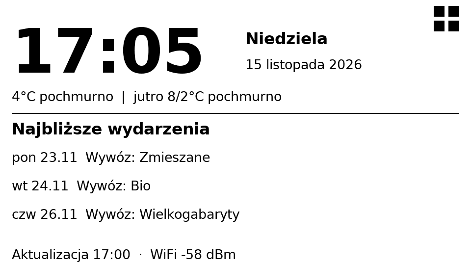
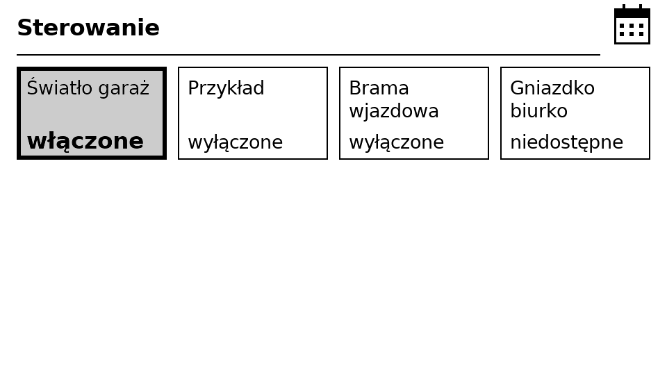

# HA_Display

Wyświetlacz na biurko z Home Assistant na **LilyGo T5 4.7" e-paper (ESP32-S3, 960×540, dotyk GT911)**.




## Struktura projektu

```
HA_Display/
├── platformio.ini          konfiguracja PlatformIO (build w C:/pio-build/ha_display)
├── boards/T5-ePaper-S3.json definicja płytki
├── src/
│   ├── main.cpp            firmware
│   ├── plsans.h, plsans_bold.h, plclock.h   fonty z polskimi znakami
│   ├── secrets.h           WiFi + token HA (nie trafia do gita)
│   └── secrets.example.h   wzór secrets.h
├── lib/LilyGo-EPD47/       sterownik ekranu z repo LilyGo-EPD47 (gałąź esp32s3) + zlib, licencja GPL-3.0
├── scripts/fontconvert_pil.py   generator fontów (Pillow)
└── docs/                   podglądy ekranów
```

Biblioteki SensorLib (dotyk) i ArduinoJson pobiera PlatformIO z `lib_deps`.

## Budowanie

1. VS Code z rozszerzeniem **PlatformIO IDE**: Plik → Otwórz folder → `HA_Display`.
2. Uzupełnij `src/secrets.h` (wzór w `src/secrets.example.h`).
3. Skompiluj (✔), wgraj (→) i otwórz monitor portu szeregowego (wtyczka).

## Konfiguracja

**Ekran (960×540):** duży zegar z NTP, dzień tygodnia i data po polsku, linia pogody, 3 najbliższe wydarzenia i linia statusu.
Raz na godzinę (o pełnej godzinie) ekran jest odświeżany w całości, żeby usunąć ghosting. Poza tym odświeżane są tylko te pola, które się zmieniły.

**Home Assistant (http://homeassistant.local, port 80):**

| Encja | Źródło |
|---|---|
| `input_text.desk_calendar_line_1..3` | automatyzacja *EPD: aktualizuj linie wyświetlacza* (calendar.get_events z `calendar.kalendarz`, 14 dni) |
| `input_text.desk_weather_line` | ta sama automatyzacja, Met.no `weather.met_no_53_1235_18_0084` |
| `sensor.desk_clock_line` | pomocnik szablonowy; firmware używa go tylko, dopóki nie zsynchronizuje czasu z NTP |

Automatyzacje w HA:
- *EPD: aktualizuj linie wyświetlacza*: przy starcie HA i co 15 min.
- *EPD: odśwież kalendarz Outlook co 15 min*: Remote Calendar domyślnie pobiera dane co 24 h.

Firmware odpytuje HA co 5 min. Przy błędzie zostawia ostatnie poprawne dane, a błąd pokazuje w linii statusu.

**Pierwsze uruchomienie:** w `src/secrets.h` uzupełnij WiFi i token HA (Profil → Bezpieczeństwo → Tokeny o długim czasie życia).

**Fonty z polskimi znakami:** `plsans.h` (DejaVu Sans 13 pt), `plsans_bold.h` (DejaVu Sans Bold 16 pt), `plclock.h` (DejaVu Sans Bold 60 pt, tylko cyfry i dwukropek).
Są wygenerowane skryptem `scripts/fontconvert_pil.py`, który wymaga tylko Pillow, np.:
```
python scripts/fontconvert_pil.py PlSans 13 DejaVuSans.ttf --compress > src/plsans.h
```
Zakresy znaków: ASCII, Latin-1, Latin Extended-A (ą ę ł ś ć ń ź ż), cudzysłowy, myślniki, „…” i €.


### Utrata połączenia z siecią lub z Home Assistant

| Sytuacja | Zachowanie |
|---|---|
| Zrywa się WiFi | Ponowne łączenie co 30 s, bez blokowania zegara. Na ekranie zostają ostatnie dane, status pokazuje „Brak WiFi od X min · dane HH:MM”. Po **30 min** bez WiFi płytka sama się restartuje. |
| HA nie odpowiada | Po pierwszym nieudanym zapytaniu pozostałe są pomijane. Kolejne próby po 1, 2, potem co 5 min. Status pokazuje „Błąd HA: brak połączenia z HA od X min · dane z HH:MM”. Przy następnej próbie adres `.local` jest szukany od nowa przez mDNS. |
| Zły lub wygasły token | Status pokazuje „HA: HTTP 401 od X min”. Reszta zapytań w tej rundzie jest pomijana. |
| Dane nieaktualne | Dane starsze niż **1 h** albo z poprzedniego dnia są rysowane na szaro, a nagłówek zmienia się na „Najbliższe wydarzenia (nieaktualne)”. |
| Restart bez sieci | Ostatnie dane są zapisane we flashu (NVS) i wyświetlane po starcie na szaro, aż przyjdą świeże. Bez NTP zegar pokazuje „--:--”. |
| Zawieszenie programu | Watchdog restartuje płytkę, jeśli pętla główna nie odezwie się przez 120 s. |
| Zegar | Po synchronizacji z NTP chodzi na wewnętrznym zegarze ESP32 także bez sieci i sam się koryguje po powrocie sieci. |
| Sieć lub HA wraca | Dane odświeżają się przy najbliższej próbie, maks. po 5 min. |

Dane z HA są podmieniane tylko wtedy, gdy uda się pobrać wszystkie 4 encje, więc na ekranie nie miesza się stara i nowa wersja.
Parametry (`STALE_AFTER_S`, `WIFI_RESTART_AFTER_MS`, `RETRY_INTERVALS_MS`, `WDT_TIMEOUT_S`) są na początku `src/main.cpp`.

**Poprawki (zrobione):**
- [x] Stare dane oznaczane jako nieaktualne (szary kolor i wiek danych w statusie).
- [x] Brak blokowania zegara: pomijanie zapytań po pierwszym błędzie, wydłużane odstępy między próbami, nieblokujące ponowne łączenie z WiFi.
- [x] Ostatnie dane zapisywane we flashu (NVS) i pokazywane po restarcie.
- [x] Restart po 30 min bez WiFi oraz watchdog.

### Dwa ekrany i sterowanie (dotyk)

Ekrany przełącza się ikoną w prawym górnym rogu:
- **Ekran 1 – informacje:** zegar, data, pogoda, wydarzenia i status. Ikona z czterema kwadratami przenosi na ekran 2. Stuknięcie w dowolne inne miejsce pobiera od razu dane z HA i odświeża cały ekran.
- **Ekran 2 – sterowanie:** kafelki 4×3 (maks. 12, każdy 216×134 px), a ikona kalendarza wraca na ekran 1. Stuknięcie w kafelek przełącza encję (`homeassistant.toggle`). Stuknięcie poza kafelkami odświeża ich stany.
  - Nazwa kafelka jest pisana zwykłą czcionką, a dłuższa przechodzi do drugiej linii. Kafelek włączony ma szare tło, grubą ramkę i pogrubiony napis „włączone”. Wyłączony ma cienką ramkę i napis „wyłączone”.
  - Gdy stanu nie da się odczytać, tekst jest szary, a kafelek pokazuje ostatni znany stan albo „niedostępne”.
  - Stany są odczytywane przy wejściu na ekran 2 i potem co 5 s (`TILE_POLL_MS`). Po przełączeniu ekran zmienia się od razu, a po 1,5 s stan jest potwierdzany odczytem z HA.
  - Bez dotyku przez 60 s (`SCREEN2_TIMEOUT_MS`) wyświetlacz wraca na ekran 1.

**Kafelki konfiguruje się w tablicy `TILE_CFG`** na początku `src/main.cpp`. Każda encja obsługująca przełączanie (light, switch, fan, input_boolean…) to jedna linia:
```cpp
static const TileCfg TILE_CFG[] = {
    {"light.light_garage_entrance_sonoff_light_garage_entrance_sonoff_light", "Światło garaż"},
    // {"switch.brama", "Brama"},
};
```

Jeśli kontroler dotyku nie zostanie wykryty, ikona się nie rysuje i dostępny jest tylko ekran 1.
